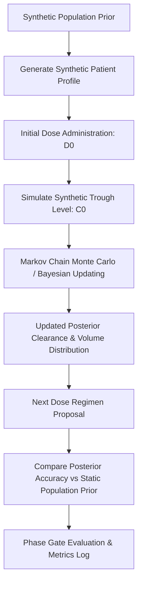

# Privavedaa Sequential Bayesian Simulation Flows

## 1. Sequential Bayesian Updating Flow



## 2. Autopilot Proposal Development Loop

```text
[.tasks/queue.json] (Curated Scoped Tasks)
         │
         ▼
[tools/autopilot_development.py]
         │ (Loopback Request)
         ▼
[Local Ollama Worker] (Model generates structured patch proposal)
         │
         ▼
[Validation Engine] (Validates syntax, types, and schema boundaries)
         │
         ▼
[.tasks/results/] (Proposal stored for manual human orchestrator review)
         │ (Requires explicit review to apply patch)
         ▼
[Repository Core / Phase Gates]
```
